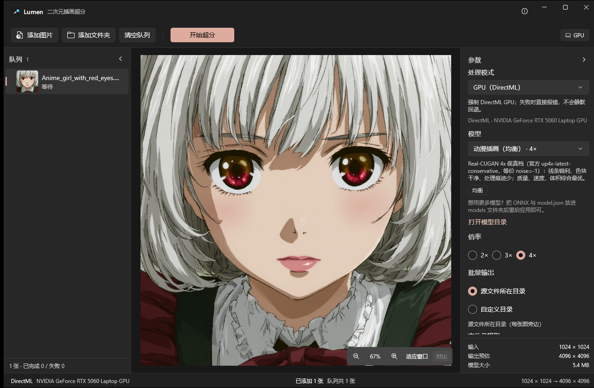

# Lumen

**端侧二次元插画超分**桌面应用。.NET 10 + C# + WinUI 3，ONNX Runtime + DirectML GPU 推理，**本地离线**，质量优先。



> 内置 1 个综合最优的动漫“均衡”模型（Real-CUGAN 4× 保真）；右侧可查看模型说明、打开模型目录，更多模型可自行下载添加。

## 特性

- **专注二次元**：内置 1 个综合最优的动漫**均衡**模型（Real-CUGAN 4× 保真，原名与获取方式见下文）；模型列表聚焦动漫，更多模型可自行下载添加。
- **纯端侧**：模型、推理、编解码全部在本机完成，不联网、无账号、无云端。
- **批量处理**：一次添加多张图片/整个文件夹/拖拽，逐张处理并显示缩略图、状态、进度、耗时与失败原因；支持自定义输出目录、文件名规则、冲突策略，完成后可一键打开输出文件夹。
- **CPU 兼容模式**：一等公民的“处理模式：自动 / GPU / CPU 兼容”。没有 DirectML 的机器自动切 CPU 并提示；兼容模式使用 fp32 + 低内存分块，8 GB 内存机器也能稳定跑。
- **质量优先**：内置动漫模型在评估集上 PSNR/SSIM 优于 Lanczos；fp16 与 fp32 数值等价。
- **无接缝分块 + 形状统一**：分块带上下文边距，边块反射 padding 统一张量形状（平均再快约 24%）。
- **原生 Windows 界面**：WinUI 3、Mica、自定义标题栏、深浅色跟随系统；没有“AI 套壳”式的渐变、发光与营销文案。
- **可诊断**：系统信息（OS/CPU/GPU/DirectML/模型目录/日志路径）、日志文件、状态条真实后端与耗时。

## 快速开始

本机（开发/构建）：

```powershell
# 1) 构建
powershell -ExecutionPolicy Bypass -File scripts/build.ps1

# 2) 运行（自动构建并启动）
powershell -ExecutionPolicy Bypass -File scripts/run.ps1

# 3) 构建可直接分发的目录产物（自带 .NET 运行时与模型）
powershell -ExecutionPolicy Bypass -File scripts/build.ps1 -Publish
# 产物：artifacts\Lumen\Lumen.exe（根目录只有 exe / models / output / README，运行时在隐藏的 runtime\）
# 4) 同时打包 zip（方便分发）
powershell -ExecutionPolicy Bypass -File scripts/build.ps1 -Publish -Zip
# 产物：artifacts\Lumen-win-x64.zip
```

运行已发布的 `Lumen.exe` 即可使用（目录约 **263 MB**，zip 约 **107 MB**；含 .NET 运行时、Windows App SDK 与 1 个内置模型；无需安装 .NET，无需管理员权限与开发者模式）。

### 发布版目录结构

解压 `Lumen-win-x64.zip`（或直接分发 `artifacts\Lumen`）后，根目录只有这些可见内容：

```
Lumen\
  Lumen.exe          ← 双击入口（启动器，12 MB，带应用图标）
  models\            ← 内置模型；用户可自行增删（见下文“自行下载/添加模型”）
  output\            ← 输出目录（可见，可把批量输出选到这里）
  README.md
  runtime\           ← 隐藏：真正的 WinUI 程序与全部运行时依赖（不要删除/移动）
```

- 分发时请**整个文件夹（或 zip）**一起给用户；只发根目录的 `Lumen.exe` 会因为找不到 `runtime\` 而弹窗提示。
- `runtime\` 默认带隐藏属性；如果解压工具保留了属性，资源管理器里只会看到 exe / models / output / README。
- 模型路径：根目录的 `models\` 会被自动识别（应用从 `runtime\` 向上查找一级）。

> 发布细节：WinUI 的 `Lumen.pri` 与 `*.xbf` 不在 `dotnet publish` 的默认复制范围，`scripts/build.ps1` 会自动从构建输出补齐（否则启动会报 `XamlParseException`）。发布版已实测双击运行、批量超分、CPU 模式与导出成功，详见 [docs/ACCEPTANCE.md](docs/ACCEPTANCE.md)。

### 环境要求（仅构建需要）

| 项 | 版本 | 说明 |
|---|---|---|
| Windows | 10 1903+ / 11 | 需 D3D12 才有 GPU 加速；也可用 CPU 兼容模式 |
| .NET SDK | 10.0.402 | 脚本会自动找 `%USERPROFILE%\dotnet10\dotnet.exe` |
| Windows App SDK | 2.5.1（NuGet） | 构建时自动还原 |
| GPU | 支持 DirectX 12 的显卡（可选） | 无独显/无 D3D12 时用 CPU 兼容模式（较慢） |

不需要 Visual Studio、不需要管理员权限、不需要开发者模式——应用以 unpackaged + self-contained 方式构建运行。

## 使用说明

1. `添加图片`（多选）/ `添加文件夹` / 直接拖入多张图片或文件夹；队列会显示每张图的缩略图与状态。
2. 右侧选择处理模式、模型、倍率（2×/3×/4×）、输出格式与批量输出设置。
3. 点 `开始处理全部`。逐张处理（GPU 上顺序执行避免显存竞争）；可随时取消；失败项不影响其它项。
4. 选中队列项查看原图/结果对比：拖中间分隔线，按住 `Space` 临时看原图；滚轮缩放、拖动平移。
5. 完成后 InfoBar 汇总“成功 N / 失败 M”，可直接打开输出文件夹；也可对选中项单独导出。

### 处理模式

| 模式 | 行为 | 适用 |
|---|---|---|
| 自动（推荐） | 有 DirectML 用 GPU + fp16；会话创建失败由引擎回退 CPU | 绝大多数机器 |
| GPU（DirectML） | 强制 GPU；失败明确报错，便于排查显卡/驱动 | 确认有独显时 |
| CPU 兼容（较慢） | CPU + fp32 + 低内存分块（tile 256）+ 线程上限，8 GB 内存安全 | 无 D3D12 / 远程桌面 / 显卡驱动异常 / 笔记本省电 |

### 快捷键

| 快捷键 | 功能 |
|---|---|
| `Ctrl+O` | 添加图片 |
| `Ctrl+S` | 导出选中项 |
| `Ctrl+=` / `Ctrl+-` | 放大 / 缩小 |
| `Ctrl+0` | 适应窗口 |
| `Space`（按住） | 临时查看原图 |
| `Esc` | 取消处理 |

## 模型

应用只内置 **1 个“均衡”模型**——按实测数据（质量 / 速度 / 体积 / 许可）综合挑选的最优解：

| 应用内 id | 显示名 | **原始模型名** | 倍率 | 大小 | 许可 | 来源 |
|---|---|---|---|---|---|---|
| `realesr-cugan-4x-conservative` | 动漫插画（均衡） | **Real-CUGAN 4× latest-conservative**（官方权重文件 `up4x-latest-conservative.pth`，位于 `updated_weights.zip`） | 4× | 5.65 MB（fp16 2.85 MB） | MIT | [bilibili/ailab Real-CUGAN](https://github.com/bilibili/ailab/tree/main/Real-CUGAN) |

> 为什么选它（开发期同机实测，3 张动漫评估图）：
> - **质量最高**：PSNR 26.05 dB / SSIM 0.9405，优于 anime-6B（23.50 / 0.9262）与 Lanczos4（22.24 / 0.8655）；
> - **速度快**：GPU 1024×1024→4096×4096 约 1.7 s（引擎总耗时，不含写盘）；CPU 兼容模式 512×512→2048×2048 约 9.6 s，比 anime-6B 快约 3.5 倍；
> - **体积最小**：仅 5.65 MB（anime-6B 17.9 MB）；
> - **许可是 MIT**（可商用），不像 4x-UltraSharp 那样限制非商业。
>
> 它是 Real-CUGAN 官方 4× latest 的 conservative（保真）档，等价 noise=-1；官方 4× 没有 Pro 版（Pro 只有 2×/3×）。应用内 `qualityTier=balanced`、`isDefault=true`。

### 自行下载 / 添加更多模型

应用不内置其他模型，但支持用户自己添加：

1. 准备一个 ONNX 模型（推荐 4×，要求见下）。
2. 在模型目录下新建文件夹（如 `models\my-model\`），放入 `model.onnx`（必需）、`model.fp16.onnx`（可选）和一个 `model.json`。
   - 发布版：`artifacts\Lumen\models\`；开发构建：仓库根目录的 `models\`。
   - 应用右侧“打开模型目录”按钮可直接打开该文件夹。
3. 重启应用，模型会出现在下拉框中（`recommendedFor` 含 `anime` 才会默认显示；其他类别可在高级设置打开“显示通用模型”）。

`model.json` 模板（字段说明见 [docs/ARCHITECTURE.md](docs/ARCHITECTURE.md) §4）：

```json
{
  "id": "my-model",
  "displayName": "我的模型",
  "description": "一句话说明",
  "scale": 4,
  "arch": "rrdb",
  "qualityTier": "balanced",
  "recommendedFor": ["anime"],
  "inputLayout": "NCHW",
  "outputLayout": "NCHW",
  "dynamicAxes": true,
  "files": { "fp32": "model.onnx", "fp16": null },
  "sizeBytes": 0,
  "sourceUrl": "",
  "license": "",
  "author": ""
}
```

ONNX 要求：输入 `[1,3,H,W]` RGB、值域 `[0,1]`、H/W 动态（导出时 `dynamic_axes`）；输出同布局、边长为输入的 `scale` 倍。`fp16` 文件可选，但若提供则输入输出应为 `tensor(float16)`。

常见可自行获取的模型（原始权重名 / 获取方式 / 许可）：

| 原始模型 | 获取方式 | 说明 |
|---|---|---|
| `up4x-latest-conservative.pth`（本应用内置） | [bilibili/ailab Real-CUGAN](https://github.com/bilibili/ailab/tree/main/Real-CUGAN)（`updated_weights.zip`） | MIT；4× 保真，本应用内置 |
| `up4x-latest-denoise3x.pth` | 同上 | MIT；4× 最强去噪 |
| `RealESRGAN_x4plus_anime_6B.pth` | [Real-ESRGAN v0.2.2.4](https://github.com/xinntao/Real-ESRGAN/releases/tag/v0.2.2.4) | BSD-3；动漫，速度/质量均衡 |
| `RealESRGAN_x4plus.pth` | [Real-ESRGAN v0.1.0](https://github.com/xinntao/Real-ESRGAN/releases/tag/v0.1.0) | BSD-3；写实照片 |
| `realesr-general-x4v3.pth` | [Real-ESRGAN v0.2.5.0](https://github.com/xinntao/Real-ESRGAN/releases/tag/v0.2.5.0) | BSD-3；极速通用 |
| `4x-UltraSharp.pth` | [Kim2091/UltraSharp](https://huggingface.co/Kim2091/UltraSharp) | CC-BY-NC-SA-4.0（**仅非商业**）；锐化 |

> 已有 ONNX 可直接放；只有 `.pth` 时，可参考 `tools/model-pipeline/`（PyTorch CPU 导出 → fp16 → 校验）自行转换。
> 没有 `model.json` 的模型不会被加载；`sha256` / `sizeBytes` 可留空，不影响使用。
> 各模型在开发期的真实质量/性能数据见 [docs/MODELS.md](docs/MODELS.md)。

## 质量与性能（本机实测：RTX 5060 Laptop 8GB / Ryzen 9 8945HX）

**质量（动漫评估集，4× vs 原图；内置模型）**

| 方法 | PSNR | SSIM |
|---|---|---|
| Real-CUGAN 4× latest-conservative（内置） | **26.05 dB** | **0.9405** |
| RealESRGAN_x4plus_anime_6B（可自行下载） | 23.50 dB | 0.9262 |
| Lanczos4 基线 | 22.24 dB | 0.8655 |

**速度**

| 场景 | 结果 |
|---|---|
| GPU：1024×1024 → 4096×4096（tile 384，9 块） | **约 1.7 s**（引擎总耗时，不含写盘；会话 0.35 s） |
| GPU：1920×1326 → 7680×5304（tile 384，24 块） | 约 2.8 s |
| CLI batch 6 张（GPU，含写盘） | 约 17.5 s（优化前 22.7 s，-23%） |
| CPU 兼容：512×512 → 2048×2048 | 约 9.6 s（tile 256；比 anime-6B 快约 3.5 倍） |
| 分块 vs 整图单块（质量验证） | PSNR 50.62 dB，接缝梯度无异常 |
| 形状一致性优化 | 平均提速约 24%（GPU） |

> fp16 与 fp32 输出差异 PSNR 62–68 dB、SSIM 0.999x（可视为等价）；CPU 模式强制 fp32。CPU 大图较慢属预期，界面会明确显示“CPU 兼容（较慢）”。

**本体优化（迭代 3，2026-10-17）**

| 项目 | 优化前 → 优化后 |
|---|---|
| 发布包（清理调试文件 + 根目录启动器布局） | 356.4 → **263.2 MB**（zip 107.1 MB） |
| 单图 1024²→4096²（引擎） | 1939 → **1705 ms**（-12%） |
| 单图 1920×1326 → 7680×5304（引擎） | 3034 → **2770 ms**（-9%） |
| CLI batch 6 张（GPU，含写盘） | 22.7 → **17.5 s**（-23%） |
| UI 添加 10 张 1920 图：缩略图 / 峰值内存 | 263 → **178 ms** / 374.8 → **229.7 MB** |
| UI 批量 9 张墙钟（Debug 对比） | 102.05 → **78.15 s**（-23%） |

> 引擎写回内联 + 批量保存流水线 + CLI 批量默认跳过预览 + 缩略图采样解码 + 预览/进度节流；CUGAN tile=384 复核为最优未改；Lanczos3 降采样试验无稳定收益已回退 Mitchell。详见 [docs/PERFORMANCE.md](docs/PERFORMANCE.md) §8、[docs/UI-NOTES.md](docs/UI-NOTES.md) §11。

## 项目结构

```
src/Lumen.Core        核心：编解码、模型目录、ONNX 推理、分块、批处理、设置、日志（不依赖 WinUI）
src/Lumen.App         WinUI 3 界面（队列/对比/参数/系统信息）
src/Lumen.Launcher    发布版根目录启动器（极小单文件 exe，拉起 runtime\Lumen.exe）
src/Lumen.Cli         命令行：list / info / upscale / batch / bench / quality
src/Lumen.Core.Tests  xunit 测试（128 个用例）
models/               内置 1 个动漫均衡模型（可自行添加更多）
tools/model-pipeline  模型下载/转换/基准脚本（Python）
docs/                 架构、迭代规格、UI/WinUI、模型、性能、验收文档
scripts/              build / run / 截图 / UIA 冒烟脚本
```

## 文档

- [docs/PLAN.md](docs/PLAN.md) — 项目大纲与里程碑
- [docs/ITERATION-2.md](docs/ITERATION-2.md) — 迭代 2 规格（二次元专精 / 批处理 / CPU 兼容）
- [docs/ARCHITECTURE.md](docs/ARCHITECTURE.md) — 架构、契约、引擎算法、批处理与 CPU 模式
- [docs/UI-DESIGN.md](docs/UI-DESIGN.md) — 界面规格与“去 AI 味”原则
- [docs/WINUI.md](docs/WINUI.md) — 本机 WinUI 3 构建/运行/截图配方
- [docs/MODELS.md](docs/MODELS.md) — 模型来源、动漫模型对比、基准、质量结论
- [docs/PERFORMANCE.md](docs/PERFORMANCE.md) — 分块/形状优化/CPU 模式性能实验
- [docs/ACCEPTANCE.md](docs/ACCEPTANCE.md) — 最终验收记录（构建/测试/真实跑图/发布/截图）
- [docs/UI-REVIEW.md](docs/UI-REVIEW.md) / [docs/UI-SMOKE.md](docs/UI-SMOKE.md) — UI 代码评审与 UIA 冒烟

## 常见问题：双击 `Lumen.exe` 打不开

**推荐的双击入口**（发布版，自带运行时与模型）：

```powershell
powershell -ExecutionPolicy Bypass -File scripts\build.ps1 -Publish
# 然后双击（或右键“运行”）：
D:\Project\Lumen\artifacts\Lumen\Lumen.exe
```

排查顺序：

1. **不要只复制根目录的 `Lumen.exe`**：它是启动器，需要同目录的 `runtime\`（真正的程序与运行时）、`models\`、`Lumen.pri`/`*.xbf` 等。移动/分发时请整个 `artifacts\Lumen` 目录（或 zip）一起拷贝。若只复制了 exe，启动器会弹窗提示“找不到程序运行文件：...\runtime\Lumen.exe”。
2. **开发构建的输出也能双击**：`src\Lumen.App\bin\x64\Debug\net10.0-windows10.0.26100.0\win-x64\Lumen.exe`（或对应 Release 路径）。注意路径里必须有 `win-x64` 子目录；没有运行时文件的旧目录里的 exe 双击会提示安装 .NET 或直接退出。
3. **重新发布一次**：发布脚本会从构建输出补齐 WinUI 的 XAML 资源（`Lumen.pri` 与 `Views\`、`Controls\` 等子目录下的 `*.xbf`），并在结束后**自动启动一次自检**；失败会直接报错，不会留下“能构建但打不开”的产物。
4. 仍然打不开时看日志：`%LOCALAPPDATA%\Lumen\logs\lumen.log`。若出现 `XamlParseException` / `Cannot locate resource`，几乎都是发布目录的 XAML 资源不完整，重新运行 `scripts\build.ps1 -Publish` 即可。
5. 系统信息：应用内标题栏右侧 `ⓘ` 可查看 DirectML/模型目录/日志路径；也可在启动失败后查看 Windows 事件查看器 → Windows 日志 → 应用程序中 `Lumen.exe` 的错误。

## 已知限制

- 输出上限 **1.5 亿像素**（UI 在 1 亿像素起给出警告）；超大图会给出中文错误而不是崩溃。
- CPU 兼容模式单块固定 256，速度明显慢于 GPU（内置 CUGAN 模型 512×512 约 9.6 s）；大图建议用 GPU。
- 色彩管理未做 ICC 转换（绝大多数图片为 sRGB），EXIF 方向已归一化。
- 原生 FileOpenPicker/FileSavePicker 未做自动化点击验证（添加/输出代码路径已由真实批量与调试变量覆盖）；多显示器 DPI 与高对比度主题未截图验证。
- 2×/3× 由 4× 输出高质量降采样得到；应用只内置 1 个模型，其他模型需用户自行下载/转换（注意各自许可）。

## 致谢

- [Real-CUGAN](https://github.com/bilibili/ailab)（MIT，bilibili）与 [Real-ESRGAN](https://github.com/xinntao/Real-ESRGAN)（BSD-3-Clause）
- [ONNX Runtime](https://github.com/microsoft/onnxruntime)、[DirectML](https://github.com/microsoft/DirectML)
- [Windows App SDK](https://github.com/microsoft/WindowsAppSDK)、[SkiaSharp](https://github.com/mono/SkiaSharp)
- 界面与工程规范参考 [microsoft/win-dev-skills](https://github.com/microsoft/win-dev-skills) 的 winui 技能

##Extra
本人是个小zako，如果这个工具对你有帮助，麻烦大人点个star喵~
