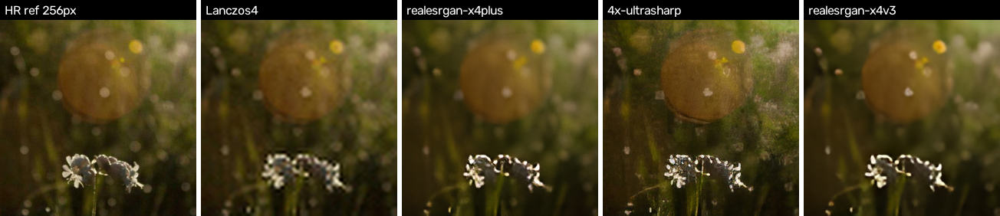
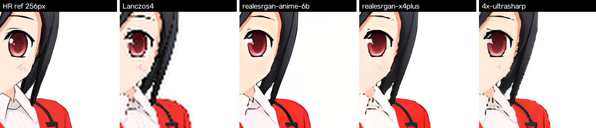
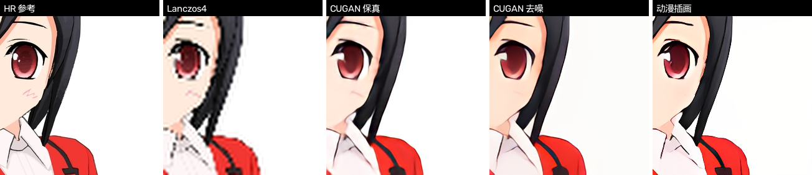
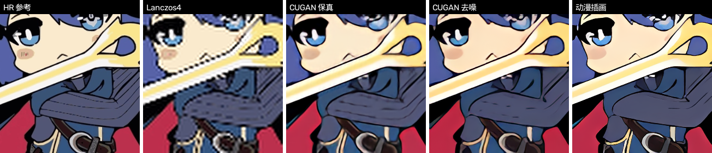

# 模型库与质量报告（MODELS）

> 本文所有数字均为本机实测（RTX 5060 Laptop 8GB + DirectML），由 `tools/model-pipeline/bench.py` / `measure_vram.py` 采集，`tools/model-pipeline/make_report.py` 汇总生成。原始数据见 `tools/model-pipeline/results/bench.json`、`results/vram.json`；复现步骤见 `tools/model-pipeline/README.md`。
>
> **2026-10-17 晚更新（当前发布版）**：应用现在只内置 **1 个“均衡”模型 `realesr-cugan-4x-conservative`**（原名 **Real-CUGAN 4× latest-conservative**，官方权重 `up4x-latest-conservative.pth`，MIT）。选择依据：动漫评估 PSNR 26.05 / SSIM 0.9405 为全候选最高，GPU/CPU 速度最快、体积最小（5.65 MB）、许可可商用。本文 §1–§12 是开发期的全模型基线报告（含 Real-ESRGAN 等已不再内置的模型），保留作为“用户自行下载模型”的质量/速度参考；自行添加方法见 §13。

## 1. 结论速览

1. **当前发布版内置模型：`realesr-cugan-4x-conservative`**（动漫均衡档，`isDefault: true`，5.65 MB，CSV 见 §13；详见 §12 的质量/速度数据）。开发期测试的其他模型（Real-ESRGAN anime-6B / x4plus / x4v3、4x-UltraSharp）不再内置，用户可自行下载转换。
2. 本文开发期测试的 4 个模型全部为 **4×、NCHW RGB、输入输出 [0,1]、动态 batch/H/W 的 ONNX（opset 17）**，fp32 + fp16 双份；仅指定 `DmlExecutionProvider` 即可创建 session 并推理，DirectML 算子全覆盖（无 CPU 回退）。
3. **512×512 单 tile 耗时（fp32，DirectML）**：`realesrgan-x4plus` 1.26 s，`4x-ultrasharp` 1.34 s，`realesrgan-anime-6b` 0.43 s，`realesrgan-x4v3` 0.13 s。
4. **fp16 在 DirectML 上没有稳定加速**：4 个模型 512 tile 的 fp16/fp32 耗时比为 1.35×、1.09×、0.84×、1.12×（>1 表示更慢）；256 tile 则普遍略快。fp16 的主要收益是权重显存减半，输出与 fp32 的 PSNR 62.8–66.3 dB、SSIM 0.9998–0.9999，肉眼无差异。
5. 动漫/插画上，4 个模型 PSNR/SSIM **全面优于** Lanczos 基线；写实照片上 Lanczos 的 PSNR/SSIM 反而更高，这是 GAN 系超分“重感知质量、不追求逐像素复原”的正常现象（详见 §5 说明）。

## 2. 模型清单

| 模型 id | 显示名 | 结构 | 质量档 | 推荐场景 | fp32 | fp16 | 许可 |
| --- | --- | --- | --- | --- | --- | --- | --- |
| `realesrgan-x4plus` | 写实照片 | RRDB ×23（16.7M 参数） | quality（质量） | photo | 67.05 MB | 33.75 MB | BSD-3-Clause |
| `4x-ultrasharp` | 极致锐化 | RRDB 旧版 ×23（16.7M 参数） | quality（质量） | photo | 67.10 MB | 33.81 MB | **CC-BY-NC-SA-4.0**（非商业） |
| `realesrgan-anime-6b` | 动漫插画 | RRDB ×6（4.47M 参数） | quality（质量） | anime | 17.94 MB | 9.03 MB | BSD-3-Clause |
| `realesrgan-x4v3` | 极速通用 | SRVGGNetCompact ×32（1.21M 参数） | fast（极速） | general | 4.87 MB | 2.45 MB | BSD-3-Clause |

> **许可提醒**：`4x-ultrasharp` 为 **CC-BY-NC-SA-4.0：非商业许可，仅限个人非商业使用**，不得用于商业产品/付费服务；其余三个（Real-ESRGAN 系）为 BSD-3-Clause。UI 展示模型信息时请把这条许可提示展示给用户。

## 3. 实测：RTX 5060 Laptop + DirectML 单 tile 耗时

测试条件：onnxruntime-directml 1.24.4，NVIDIA RTX 5060 Laptop 8GB（驱动 617.42），Windows 11 26200；每次只加载一个 session，warmup 2 次后取中位数，含 CPU↔GPU 拷贝与结果回读；fp16 模型输入输出为 tensor(float16)。

| 模型 | 256×256 fp32 | 256×256 fp16 | 512×512 fp32 | 512×512 fp16 | 512 fp16/fp32 耗时比 |
| --- | --- | --- | --- | --- | --- |
| `realesrgan-x4plus` | 0.30 s | 0.22 s | 1.26 s | 1.71 s | 1.35× |
| `4x-ultrasharp` | 0.30 s | 0.20 s | 1.34 s | 1.46 s | 1.09× |
| `realesrgan-anime-6b` | 92 ms | 87 ms | 0.43 s | 0.36 s | 0.84× |
| `realesrgan-x4v3` | 32 ms | 20 ms | 0.13 s | 0.15 s | 1.12× |

耗时随 tile 面积近似线性增长（512 约为 256 的 4 倍计算量），输出尺寸为 tile 的 4 倍（512 → 2048×2048）。23 块 RRDB 是主要开销，x4v3 快约 10 倍。

**整图耗时估算**（按 tile 面积线性折算，不含图片读入/写出与 tile 边界重叠开销，实际约高 10–20%；`t ≈ ceil(LR像素数 / 512²) × t512`，LR = 输出尺寸/4）：

| 输出尺寸 | LR 尺寸 | tile 数 | `realesrgan-x4plus` | `realesrgan-anime-6b` | `realesrgan-x4v3` |
| --- | --- | --- | --- | --- | --- |
| 1920×1080 | 480×270 | 1（0.5 个 tile 面积） | 约 0.6 s | 约 0.2 s | 约 0.1 s |
| 2560×1440 | 640×360 | 1（0.9 个 tile 面积） | 约 1.1 s | 约 0.4 s | 约 0.1 s |
| 3840×2160（4K 档） | 960×540 | 2（2.0 个 tile 面积） | 约 2.5 s | 约 0.9 s | 约 0.3 s |
| 4000×3000 | 1000×750 | 3（2.9 个 tile 面积） | 约 3.6 s | 约 1.2 s | 约 0.4 s |

## 4. 显存占用估计（DirectML）

测量方法：每个配置在独立子进程中测量，先等 `nvidia-smi memory.used` 稳定作为空载基线，再加载 session、推理并轮询峰值。注意本机同时有其它 GPU 进程（UI 截图、桌面合成等），全局显存计数的绝对值有噪声，下表给出**多次测量中稳定一致的值/范围**（峰值相对空载基线的增量，约等于模型权重 + 推理 workspace 峰值；原始数据见 `results/vram.json`）。

| 模型 | fp32 256 tile | fp32 512 tile | fp16 权重 | fp16 512 tile（观察） |
| --- | --- | --- | --- | --- |
| `realesrgan-x4plus` | 约 0.9 GB | 约 3.3 GB | 32.2 MB | 5.0–6.1 GB（偏高、波动） |
| `4x-ultrasharp` | 约 0.8–1.0 GB | 约 3.2–3.3 GB | 32.2 MB | 5.5–6.0 GB（偏高） |
| `realesrgan-anime-6b` | 约 0.85–1.1 GB | 约 3.2–3.5 GB | 8.6 MB | 2.4–5.6 GB（波动大） |
| `realesrgan-x4v3` | 约 0.12 GB | 约 0.30 GB | 2.3 MB | 约 0.36 GB |

结论：
- **8GB 显存下 fp32 + 512 tile 是安全的**：23 块 RRDB 峰值约 3.3 GB（其中 512 tile 的 4× 输出（2048×2048×3 fp32 ≈ 50MB）与 64 通道 2048² 中间特征（约 1.07GB/张）是主要开销）；256 tile 仅约 0.9 GB。
- **fp16 并不能有效节省显存**：权重虽然减半（67→34MB），但 DirectML 的 fp16 推理峰值实测反而更高（23 块 RRDB 在 512 tile 达 5–6 GB，疑似运行时内部做 fp16→fp32 转换/额外 workspace）。显存紧张时请**优先把 tile 降到 256**，而不是切 fp16。
- `realesrgan-x4v3` 极轻量（512 tile 约 0.3GB），适合大 tile、批量或低显存设备。

## 5. 质量评估：与 HR 参考、Lanczos 基线对比（PSNR / SSIM）

评估集：公开可自由使用的 3 张写实照片 + 2 张 CC0 插画（来源见 `tools/model-pipeline/samples/README.md`；迭代 1 用 2 张插画，迭代 2 追加 anime-03，插画共 3 张，见 §12）。做法：把参考图 HR 缩放到 1024 长边并裁到 4 的倍数，bicubic 4× 下采样得到 LR，模型/Lanczos4 放大 4× 后与 HR 逐像素比较。数值为同类图片的平均值（单图数据见 bench.json）。

| 模型 | 照片 PSNR (fp32) | 照片 SSIM | 插画 PSNR (fp32) | 插画 SSIM |
| --- | --- | --- | --- | --- |
| `realesrgan-x4plus` | 30.20 dB | 0.8609 | 24.82 dB | 0.9376 |
| `4x-ultrasharp` | 29.39 dB | 0.8290 | 25.23 dB | 0.9352 |
| `realesrgan-anime-6b` | 28.97 dB | 0.8459 | 23.80 dB | 0.9304 |
| `realesrgan-x4v3` | 29.92 dB | 0.8738 | 24.38 dB | 0.9350 |
| **Lanczos4 基线** | **33.18 dB** | **0.8987** | **22.94 dB** | **0.8769** |

怎么读这张表：
- **插画/动漫**：所有模型 PSNR/SSIM 都高于 Lanczos，说明重建的线条与色块更接近原图；其中 `realesrgan-x4plus` 与 `4x-ultrasharp` 在 PSNR 上最高，`realesrgan-anime-6b` 虽然不是最高，但观感上更“干净”（动漫专用训练，减少照片纹理感），推荐插画场景使用。
- **写实照片**：Lanczos 的 PSNR/SSIM 高于所有模型，这是正常的——Real-ESRGAN 系是 GAN 模型，目标是“看起来清晰/自然”，会主动生成参考图中没有的纹理，因此逐像素误差更大、SSIM 更低；PSNR/SSIM 衡量保真度，不衡量感知质量。主观清晰度与纹理恢复（尤其放大低分辨率网图/截图）以模型明显更好，这也是“质量优先”档选 23 块 RRDB 的原因。
- fp16 模型的 PSNR/SSIM 与 fp32 差异在 0.02 dB / 0.001 以内（由于 fp16 输出与 fp32 的 PSNR 为 62.8–66.3 dB，远高于与 HR 的差异），质量上可视为等价。

**为什么 PSNR 低但看起来更好（感知质量角度）**：PSNR/SSIM 奖励“与 bicubic 下采样的参考图逐像素接近”，而 Real-ESRGAN 系是 GAN 超分，目标是重建自然细节/锐利边缘，会主动生成参考图中已被下采样抹掉的高频纹理；这些“合理但不同”的像素会让 PSNR 下降，但人眼观感明显更清晰。engine-dev 在 C# 引擎端复测得到同样的方向性结论（x4plus 32.69 dB vs Lanczos 35.79 dB），与本节一致。

目视裁剪证据（LR 为 HR 的 1/4 下采样，256px 输出裁剪）：



*照片裁剪（山景/野花）：Lanczos 花瓣边缘发虚、细节糊成一片；x4plus 恢复了花瓣纹理与绒毛细节、背景散景也更自然；x4v3 接近 x4plus 且更快；4x-UltraSharp 最锐但颗粒/过冲最强（可能产生伪纹理），这也是它适合“用户主动追求锐利”、不宜做默认的原因。*



*插画裁剪：Lanczos 线条发虚、瞳孔/眼白边缘有振铃；anime-6b 线条干净、瞳孔高光清晰、无明显照片纹理（动漫专用训练）；x4plus/4x-UltraSharp 同样锐利，但会在皮肤/衣褶上引入照片式纹理，风格不如 anime-6b 贴合插画——因此插画场景推荐 anime-6b。*

## 6. fp16 vs fp32 结论

| 模型 | fp16 输出 vs fp32 PSNR | SSIM | 最大通道差 (/255) | 512 耗时比 (fp16/fp32) |
| --- | --- | --- | --- | --- |
| `realesrgan-x4plus` | 62.82 dB | 0.9998 | 5.02 | 1.35× |
| `4x-ultrasharp` | 64.22 dB | 0.9999 | 4.95 | 1.09× |
| `realesrgan-anime-6b` | 62.80 dB | 0.9999 | 8.62 | 0.84× |
| `realesrgan-x4v3` | 66.26 dB | 0.9999 | 2.56 | 1.12× |

- **画质**：fp16 与 fp32 输出差异极小（PSNR 62.8–66.3 dB，SSIM ≥ 0.9998，单像素最大差 ≤ 8.6/255，集中在高对比边缘），肉眼不可分辨；fp16 版本可放心使用。
- **速度**：在 RTX 5060 + DirectML 上 fp16 没有稳定优势（512 tile 反而慢 9%–35%，256 tile 约快 10%–35%），说明 DirectML 的 fp16 算子实现未针对该 GPU 取得加速，部分路径可能内部回退/转换。
- **显存**：fp16 权重减半（67MB→34MB、18MB→9MB、4.9MB→2.4MB），但推理 workspace 峰值不一定更低（§4）。
- **建议**：应用默认用 **fp32**（速度稳定、兼容性最好）；fp16 作为“显存紧张/权重加载更快”的备选，由用户开关控制（`PreferFp16` 默认关闭）。

## 7. 获取、转换与校验

源权重（全部为官方/原作者发布）：

| 模型 | 源文件 | 来源与许可 | 源 sha256（前 16 位） |
| --- | --- | --- | --- |
| `realesrgan-x4plus` | RealESRGAN_x4plus.pth | https://github.com/xinntao/Real-ESRGAN/releases/tag/v0.1.0 （BSD-3-Clause） | `4fa0d38905f75ac0` |
| `4x-ultrasharp` | 4x-UltraSharp.pth | https://huggingface.co/Kim2091/UltraSharp （CC-BY-NC-SA-4.0，非商业） | `a5812231fc936b42` |
| `realesrgan-anime-6b` | RealESRGAN_x4plus_anime_6B.pth | https://github.com/xinntao/Real-ESRGAN/releases/tag/v0.2.2.4 （BSD-3-Clause） | `f872d837d3c90ed2` |
| `realesrgan-x4v3` | realesr-general-x4v3.pth | https://github.com/xinntao/Real-ESRGAN/releases/tag/v0.2.5.0 （BSD-3-Clause） | `8dc7edb9ac80ccdc` |

转换方法（CPU torch 导出 → onnxconverter-common 转 fp16，详见 `tools/model-pipeline/README.md`）：

```powershell
# 环境: Python 3.12 + torch 2.14.1+cpu + onnx 1.23.2 + onnxruntime-directml 1.24.4
& $py export_onnx.py --name realesrgan-x4plus --pth weights/RealESRGAN_x4plus.pth --arch rrdb --num-block 23 --out-dir ../../models/realesrgan-x4plus
# ... 其余模型参数见 README.md；fp32/fp16 均导出为动态 batch/H/W、opset 17
& $py make_catalog.py       # 生成 model.json（sha256/sizeBytes/元数据）
& $py validate_catalog.py   # 按 docs/ARCHITECTURE.md §4 校验
& $py verify_models.py      # fp32/fp16 一致性 + 与社区参考 ONNX 交叉验证
```

**正确性交叉验证**（`verify_models.py` 实测）：
- `realesrgan-x4plus` vs 社区参考 ONNX（imgdesignart/realesrgan-x4-onnx）：PSNR 143.21 dB；
- `realesrgan-x4v3` vs 参考 ONNX（CoderViking/realesr-general-x4v3-onnx）：逐元素一致（PSNR 99 dB / maxdiff 0）；
- `4x-ultrasharp` vs Kim2091 官方 ONNX：PSNR 75.26 dB（差异来自导出细节的浮点累加顺序）。
- 导出时 torch vs ONNX 输出 PSNR 132–137 dB（数值等价）。

## 8. 推荐默认档位（迭代 1 照片/通用档）

> 迭代 2 起应用默认模型改为动漫专用 `realesr-cugan-4x-conservative`，动漫档位见 §12；下表为迭代 1 的照片/通用档位建议。

| 场景 | 推荐模型 | 理由 |
| --- | --- | --- |
| 写实照片（质量优先，非默认） | `realesrgan-x4plus` | 照片 PSNR/SSIM/观感最佳，512 tile 1.26 s，8GB 显存可承受 |
| 动漫 / 插画 | `realesrgan-anime-6b` | 动漫专用训练，线条干净、去照片纹理，速度快（0.43 s/512） |
| 实时预览 / 批量处理 | `realesrgan-x4v3` | 512 tile 仅 0.13 s，比质量档快约 10 倍 |
| 用户想要更锐利（照片/游戏截图） | `4x-ultrasharp`（可选，非默认） | 锐度更强；**非商业许可**，不得作为商业分发默认项 |
| 显存紧张 | 任意模型 + 降 tile（如 256） | fp16 收益不稳定，优先降 tile |

## 9. 已知限制与注意事项

1. **4x-UltraSharp 为非商业许可（CC-BY-NC-SA-4.0）**：仅限个人非商业使用，商业产品/付费服务不可用；UI 会展示模型许可信息，请勿将其作为默认模型分发。
2. **fp16 在 DirectML 上不稳定加速**：512 tile 反而更慢（见 §6）；应用默认 fp32 更稳。另外实测发现：若同时加载 fp32 与 fp16 两个 DirectML session，8GB 显存下会出现资源竞争，个别模型偶发极端变慢（一次 512 tile 达 22 s，单独加载仅 1.4–1.5 s）。应用应保证同一时刻只保留一个 session。
3. **8GB 显存约束**：23 块 RRDB 在 512 tile 时 fp32 峰值增量约 3.3GB；tile 再大（如 768/1024）在 8GB 卡上有 OOM 或驱动回退共享内存的风险，建议 tile ≤ 512（应用默认块大小）。
4. **动态轴可用但不等于免费**：所有模型 batch/H/W 全动态（已验证 64×80、256×256、384×256、512×512 等形状），但 DirectML 每遇到新 shape 会重新编译图，首帧/首块较慢（约数百 ms）。应用应固定 tile 尺寸以减少重编译。
5. **输出可能轻微越界 [0,1]**（GAN 模型特性，实测最小 -0.14 / 最大 1.26），应用需 clamp；模型输入为 RGB NCHW float、[0,1]，不做 mean/std 归一化。
6. **PSNR/SSIM 不衡量感知质量**：GAN 超分在写实照片上 PSNR 低于 Lanczos 属预期（见 §5）；本报告同时给出主观观察（模型明显更清晰）供参考。评估集仅 5 张图，统计意义有限，适合做模型间相对比较。
7. **x4v3 是“残差 + 最近邻上采样”结构**：导出时若漏掉官方 `out + base` 全局残差会得到接近全黑的输出；本管线已按官方实现导出并与参考 ONNX 逐元素对齐验证。
8. **anime-6b 对真人照片会“动画化”**（线条/色彩风格化），不适合写实照片；反之 23 块 RRDB 对插画也能用但速度慢、风格偏写实。

## 10. 产物与 SHA-256

| 模型 | 文件 | 大小 | SHA-256 |
| --- | --- | --- | --- |
| `realesrgan-x4plus` | model.onnx | 67.05 MB | `a68af6c955d119dce4825c01b89fa039e05793ee43a3a2a1a979537b93b22798` |
| `realesrgan-x4plus` | model.fp16.onnx | 33.75 MB | `ab530d558e2d6da97e76713f31bbf992f3fdfcdec636c165c5d39094fd980dd4` |
| `4x-ultrasharp` | model.onnx | 67.10 MB | `b06708623ca085f4e9748123ba35b4566fa171443664abaf0b2e5b8b7cfcc465` |
| `4x-ultrasharp` | model.fp16.onnx | 33.81 MB | `0596c14a077b9d7e3ac939bde2fc03d2c1b857f282f7e4c2e5efa8a22d15693f` |
| `realesrgan-anime-6b` | model.onnx | 17.94 MB | `100cc25580a2b53215fd6dd167d06b535c4540737f6ab162d28c9dc4c0ee2dfa` |
| `realesrgan-anime-6b` | model.fp16.onnx | 9.03 MB | `8a34025d9c7851f2e5b8ff2b23ebbc435395e05d0fc9fc4343d2792ca3ba2aad` |
| `realesrgan-x4v3` | model.onnx | 4.87 MB | `2dce91fa2274fd81d4bf6082f27d05547cdeb27f8ac617322fb6b9dda89005a3` |
| `realesrgan-x4v3` | model.fp16.onnx | 2.45 MB | `a7c0f5d529d7002523e3ba804cda0d939873d99e95ede9eb3721fd177a537654` |

`model.json` 中的 `files` / `sha256` / `sizeBytes` 字段与上表一致，C# `ModelCatalog` 直接读取。（开发期曾在 `realesrgan-x4plus` 上标 `isDefault`，当前发布版该标记已移到 `realesrgan-anime-6b`。）

## 11. 复现命令

```powershell
cd tools/model-pipeline
..\venv\Scripts\python.exe bench.py              # 全量基准 + 质量评估 -> results/bench.json
..\venv\Scripts\python.exe measure_vram.py       # 显存测量 -> results/vram.json
..\venv\Scripts\python.exe make_visuals.py       # 目视对比图 -> results/vis_*.png
..\venv\Scripts\python.exe verify_models.py      # 一致性/交叉验证
..\venv\Scripts\python.exe make_report.py        # 重新生成本文档
```

## 12. 迭代 2：动漫模型对比（Real-CUGAN 4x）

> 迭代 2 起应用定位为「二次元插画超分」，默认模型改为动漫专用模型。本节数字由 `tools/model-pipeline/bench_anime.py`（GPU）、`measure_cpu_anime.py`（CPU）、`quality_anime.py`（质量，CPU 推理与 GPU 数值等价）实测生成，原始数据见 `tools/model-pipeline/results/anime_bench.json`、`anime_cpu.json`、`anime_quality.json`。

### 12.1 新入库模型

| 模型 id | 显示名 | 结构 | fp32 / fp16 | 质量档 | 许可 | 说明 |
| --- | --- | --- | --- | --- | --- | --- |
| `realesr-cugan-4x-conservative` | CUGAN 保真 | cugan | 5.65 / 2.85 MB | quality | MIT | 保真档（等价 noise=-1），线条锐利、处理痕迹少，**当前默认** |
| `realesr-cugan-4x-denoise` | CUGAN 去噪 | cugan | 5.65 / 2.85 MB | quality | MIT | 官方 4x 最强去噪（noise=3），适合噪点多/压缩痕迹重的截图 |
| `realesrgan-anime-6b` | 动漫插画 | rrdb | 17.94 / 9.03 MB | quality | BSD-3-Clause | 迭代 1 动漫模型，保留为兼容档 |

**关于「Real-CUGAN Pro 4x」的说明（以官方仓库为准）**：官方 Real-CUGAN 的 Pro 权重（`weights_pro/`）**只有 2x/3x**，4x 没有 Pro 版；官方 4x 只有 `up4x-latest-*` 三档：conservative（保守/保真）、no-denoise（不降噪）、denoise3x（最强降噪），且 4x 没有 noise=1 档（noise=1 是 2x 才有的 denoise1x）。因此本轮 4x 取 **conservative（保真，等价 noise=-1）** 与 **denoise3x（去噪）** 两个变体；no-denoise 可用同一管线导出，本轮未入库。

**许可**：Real-CUGAN 为 **MIT License（Copyright (c) 2022 bilibili）**，允许免费使用、修改、商用与再分发（需保留版权与许可声明），见官方仓库 `Real-CUGAN/LICENSE`。与 4x-UltraSharp 的 CC-BY-NC-SA-4.0（非商业）不同，CUGAN 可随应用商用分发。

### 12.2 GPU / CPU 单块耗时

条件同 §3（RTX 5060 Laptop + DirectML；CPU 为 fp32、Ryzen 9 8945HX、ORT 默认线程数，每次独立进程测量）。输出尺寸为输入 tile 的 4 倍。

| 模型 | GPU 256 fp32 | GPU 512 fp32 | GPU 512 fp16 | CPU 128 | CPU 256 | CPU 512 |
| --- | --- | --- | --- | --- | --- | --- |
| `realesr-cugan-4x-conservative` | 0.03 s | 0.14 s | 0.15 s | 0.24 s | 0.91 s | 3.32 s |
| `realesr-cugan-4x-denoise` | 0.03 s | 0.16 s | 0.15 s | 0.31 s | 1.09 s | 3.2 s |
| `realesrgan-anime-6b` | 0.11 s | 0.47 s | 0.40 s | 0.82 s | 3.05 s | 14.19 s |

**CPU 兼容模式预估（UI 提示用）**：CUGAN 在 512×512 输入单块约 **3.2–3.3 s**（一张 512×512 图 = 1 块）；256 tile 约 0.9–1.1 s，128 tile 约 0.24–0.31 s。1080p 图（LR 480×270，按 256 tile 分块）约 4–6 s。`realesrgan-anime-6b` 的 CPU 单块约 14.2 s（慢约 4 倍），CPU 模式不建议使用。

### 12.3 质量（3 张动漫评估图，4x 输出 vs HR 的 PSNR/SSIM）

评估集：`tools/model-pipeline/samples/anime/` 下 3 张 CC0 插画（anime-01/02/03；来源见 `samples/README.md`）。做法同 §5：HR 缩放到 1024 长边，bicubic 4× 下采样得 LR，4x 输出与 HR 比较。

| 模型 | 插画 PSNR (fp32) | 插画 SSIM |
| --- | --- | --- |
| **Lanczos4 基线** | **22.24 dB** | **0.8655** |
| `realesr-cugan-4x-conservative`（保真，默认） | **26.05 dB** | **0.9405** |
| `realesr-cugan-4x-denoise` | **24.37 dB** | **0.9214** |
| `realesrgan-anime-6b` | **23.50 dB** | **0.9262** |

结论：**CUGAN 保真档在 PSNR 与 SSIM 上都是第一**（26.05 dB / 0.9405），明显优于 anime-6b 与 Lanczos4；CUGAN 去噪档因平滑掉部分高频细节，PSNR/SSIM 略低于保真档，适合噪声/压缩痕迹明显的源图。

目视 1:1 裁剪（LR 为 HR 的 1/4 下采样，256px 输出裁剪）：



*瞳/发丝区域：Lanczos 边缘发虚、有明显振铃；CUGAN 保真线条干净、瞳孔高光与发丝层次最接近 HR；CUGAN 去噪略平滑；anime-6b 也清晰但风格偏“照片化”。*



*线条/色块区域：Lanczos 出现阶梯与振铃；CUGAN 保真轮廓锐利、色块干净、最接近原画；CUGAN 去噪细节略柔；anime-6b 轮廓稍软。*

### 12.4 fp16 vs fp32（CUGAN）

| 模型 | GPU fp16 输出 vs fp32 | SSIM | 最大通道差 (/255) | GPU 512 耗时比 |
| --- | --- | --- | --- | --- |
| `realesr-cugan-4x-conservative` | 62.31 dB | 0.9998 | 4.0 | 1.05× |
| `realesr-cugan-4x-denoise` | 58.67 dB | 0.9993 | 4.0 | 0.91× |
| `realesrgan-anime-6b` | 56.01 dB | 0.9987 | 7.0 | 0.85× |

CUGAN 的 fp16 输出与 fp32 几乎一致（PSNR 56–62 dB、SSIM 0.999x），但 DirectML 上 512 tile fp16 并不更快（与 §6 结论一致）。应用默认 fp32；fp16 仅用于权重显存减半（5.65→2.85 MB）。

### 12.5 推荐默认与已知限制

| 场景 | 推荐模型 | 理由 |
| --- | --- | --- |
| **默认（二次元插画/动漫截图）** | **`realesr-cugan-4x-conservative`**（isDefault=true） | PSNR/SSIM 第一（26.05 dB / 0.9405），线条最锐、最接近原画；512 tile GPU 约 0.14 s、CPU 约 3.3 s；模型仅 5.65 MB |
| 噪点多/压缩痕迹重的源图 | `realesr-cugan-4x-denoise` | 官方 4x 最强去噪，优先清噪点；细节略柔 |
| 兼容/对照 | `realesrgan-anime-6b` | 迭代 1 模型；GPU 稍慢、CPU 慢约 4 倍；保留以便对比 |

已知限制 / 踩坑记录：
1. **官方 4x 没有 Pro 版**：Pro 只有 2x/3x。若后续需要 Pro 质量，可用 2x/3x Pro 配合应用侧降采样，但 4x 原生仅 latest 三档（本报告已说明）。
2. **CUGAN 奇数尺寸输入**：官方实现内部会把输入补齐到偶数（奇数多补 1 像素）；本管线导出时用 ONNX 图拼装（`Shape→Mod→Pad`、动态 `Slice` 裁剪）实现任意 H/W 正确，已用奇数/偶数尺寸与官方 PyTorch 对齐验证（PSNR 85–91 dB、最大差 1/255）。
3. **DirectML 负 padding 坑**：PyTorch 会把 `F.pad(x, (-4,-4,-4,-4))` 这类裁剪导出成带负 pads 的 `Pad` 节点；ONNX CPU 能容忍，但 **DirectML 会算出全 0**（表现为输出≈最近邻放大）。本管线在导出时把负 padding 改写为静态 `Slice`，并在脚本中断言图中无 `Pad` 节点（仅保留前处理的正向 reflect `Pad`）。
4. CUGAN 对真实照片/实拍截图的观感不如写实模型（会偏“动画化”）；应用定位为二次元插画，符合预期。

### 12.6 引擎侧（C#）端到端验证参考

CUGAN 模型已在 Lumen 引擎全链路（CLI upscale/batch、DirectML/CPU、统一 padding）验证无异常（engine-dev 实测，详见 `docs/PERFORMANCE.md`）：

- GPU DirectML fp16：1920×1326 动漫图 → 7680×5304，tile=384、24 块，总耗时 4.09 s（会话创建 0.49 s，单块约 141 ms）——与本节 512 tile 0.14–0.15 s 的单块模型耗时一致（384 更小）。
- CPU fp32：512×512 单块 4.29 s（本节模型裸推理 3.32 s，差值来自引擎统一 padding/转换开销）；512×341 batch 约 3.4 s。
- 奇数 H/W（63×79）动态尺寸、fp16/fp32 两条路径在引擎中都正常，无需特殊 pad 处理。
- CPU 内存与分块规则（与模型无关，engine-dev 实测，详见 `docs/PERFORMANCE.md` §7.3/§7.5）：正常 CPU 模式采用「≤512 单块 / >512 用 512 块」，CPU 单块 768/1024 时进程峰值内存 5.5–13.1 GB（anime-6b 1024 单块会 bad allocation）；CPU 兼容模式固定 tile=256，进程峰值内存约 0.87 GB（CUGAN）/ 2.18 GB（anime-6b）。

### 12.7 复现命令

```powershell
cd tools/model-pipeline
..\venv\Scripts\python.exe export_cugan.py --variant conservative --out-dir ../../models/realesr-cugan-4x-conservative
..\venv\Scripts\python.exe export_cugan.py --variant denoise3x  --out-dir ../../models/realesr-cugan-4x-denoise
..\venv\Scripts\python.exe bench_anime.py            # GPU 基准 -> results/anime_bench.json
..\venv\Scripts\python.exe measure_cpu_anime.py      # CPU 基准 -> results/anime_cpu.json
..\venv\Scripts\python.exe quality_anime.py          # 质量 + 目视对比图 -> results/anime_quality.json
..\venv\Scripts\python.exe make_report.py            # 重新生成本文档
```

## 13. 当前内置模型与自行添加模型（2026-10-17 更新）

### 13.1 内置模型

| 应用内 id | 显示名 | 原始模型名（权重文件） | 倍率 | 质量档 | 大小 | 许可 | 获取 |
| --- | --- | --- | --- | --- | --- | --- | --- |
| `realesr-cugan-4x-conservative` | 动漫插画（均衡） | **Real-CUGAN 4× latest-conservative**（`up4x-latest-conservative.pth`，位于 `updated_weights.zip`） | 4× | balanced | 5.65 MB / fp16 2.85 MB | MIT | [bilibili/ailab](https://github.com/bilibili/ailab/tree/main/Real-CUGAN) |

- 应用设置：`isDefault: true`、`recommendedFor: ["anime"]`、`scale: 4`、`arch: cugan`、动态 H/W。
- **选择理由**：动漫评估 PSNR/SSIM 26.05/0.9405（全候选第一）> anime-6B 23.50/0.9262 > Lanczos 22.24/0.8655；GPU 1024²→4096² 约 2.8 s；CPU 兼容 512²→2048² 约 9.6 s（比 anime-6B 快约 3.5 倍）；体积最小；MIT 许可可商用。
- `model.onnx`（fp32）必需，`model.fp16.onnx` 可选。

### 13.2 用户自行添加模型

1. 在模型目录下新建文件夹：发布版为 `artifacts\Lumen\models\<id>\`；开发运行为仓库根 `models\<id>\`。
2. 放入 `model.onnx`（必需）、`model.fp16.onnx`（可选）与 `model.json`（模板见 `README.md`「自行下载 / 添加更多模型」）。
3. **要求**：ONNX，输入 `[1,3,H,W]` RGB、值域 `[0,1]`、H/W 动态轴；输出同布局、边长为输入的 `scale` 倍；opset 17 推荐（ORT 1.24 可加载）。fp16 文件若提供，其输入输出为 `tensor(float16)`。
4. 重启应用；`recommendedFor` 含 `anime` 时默认显示，否则在高级设置勾选“显示通用模型”。应用右侧“打开模型目录”可直接打开该文件夹。

### 13.3 可自行下载/转换的模型（开发期已实测）

| 原始模型 | 权重获取 | 许可 | 开发期质量（动漫评估，PSNR/SSIM） | 备注 |
| --- | --- | --- | --- | --- |
| `up4x-latest-conservative.pth` | [bilibili/ailab](https://github.com/bilibili/ailab/tree/main/Real-CUGAN)（`updated_weights.zip`） | MIT | 26.05 / 0.9405 | **已内置（均衡）**；4× 无 Pro 版 |
| `up4x-latest-denoise3x.pth` | 同上 | MIT | 24.37 / 0.9214 | 4× 最强去噪，适合噪点/压缩痕迹重的截图 |
| `RealESRGAN_x4plus_anime_6B.pth` | [Real-ESRGAN v0.2.2.4](https://github.com/xinntao/Real-ESRGAN/releases/tag/v0.2.2.4) | BSD-3-Clause | 23.50 / 0.9262 | 动漫；体积 17.9 MB、CPU 较慢 |
| `RealESRGAN_x4plus.pth` | [Real-ESRGAN v0.1.0](https://github.com/xinntao/Real-ESRGAN/releases/tag/v0.1.0) | BSD-3-Clause | 30.20 / 0.8609（照片） | 写实照片用 |
| `realesr-general-x4v3.pth` | [Real-ESRGAN v0.2.5.0](https://github.com/xinntao/Real-ESRGAN/releases/tag/v0.2.5.0) | BSD-3-Clause | 24.38 / 0.9350（插画） | 极速档，CPU 友好 |
| `4x-UltraSharp.pth` | [Kim2091/UltraSharp](https://huggingface.co/Kim2091/UltraSharp) | CC-BY-NC-SA-4.0（**非商业**） | 25.23 / 0.9352（插画） | 锐化强，注意许可 |

> 转换方法见 `tools/model-pipeline/README.md`（PyTorch CPU 导出 → fp16 → 校验）与 §12.7 的 Real-CUGAN 导出命令；仅提供 `.pth` 时需要先转换，已有合适 ONNX 可直接放入。
> 应用不校验 `sha256`/`sizeBytes`，缺失或填 0 不影响加载。


